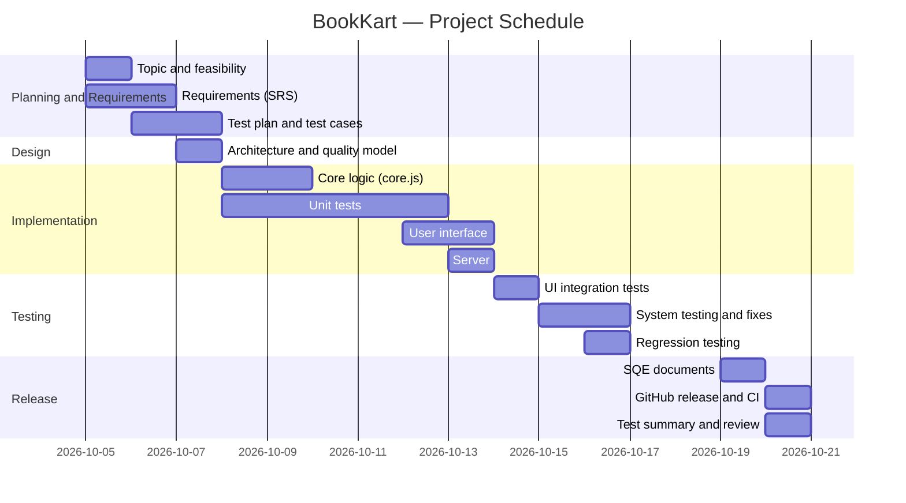

# Project Planner

## BookKart — Online Bookstore

**Subject:** Software Quality Engineering
**Student Name:** M. Arslan
**Roll No:** S24BSEEN1M01102
**University:** The Islamia University of Bahawalpur
**Project Duration:** 5 October 2026 – 20 October 2026 (12 working days)
**Development Model:** Iterative, aligned with the V-Model (every development phase has a matching testing phase)

---

## 1. Purpose of This Planner

This planner is the management plan for the BookKart project. It breaks the project into phases and tasks (Work Breakdown Structure), fixes the schedule with start and finish dates, marks the milestones that show real progress, lists the resources and tools used, and records the main risks with their handling. It was prepared before development started and updated as tasks completed.

## 2. Project Objectives

- Build a working online bookstore (catalog, search, cart, promo codes, checkout).
- Apply Software Quality Engineering in practice: testable requirements, formal test design, automated testing, defect management and quality metrics.
- Deliver the complete SQE document set and publish the project on GitHub.

## 3. Work Breakdown Structure (WBS)

| WBS | Phase / Task | Output |
|---|---|---|
| 1.0 | **Planning & Requirements** | |
| 1.1 | Topic selection & feasibility study | Approved project topic |
| 1.2 | Requirements gathering & SRS | SRS document |
| 1.3 | Test planning & test case design | Test plan, designed test cases |
| 2.0 | **Design** | |
| 2.1 | Architecture & quality model (ISO 25010) | Layered design: core logic / UI / styling |
| 3.0 | **Implementation** | |
| 3.1 | Core business logic (core.js) | Search, cart, discount, delivery, validation, orders |
| 3.2 | Unit tests written alongside code | tests/core.test.js |
| 3.3 | User interface (index.html, app.js, styles.css) | Working bookstore pages |
| 3.4 | Local server (server.js) | App runnable with `npm start` |
| 4.0 | **Testing** | |
| 4.1 | UI integration tests (jsdom) | tests/ui.test.js |
| 4.2 | System testing & defect fixing | Defect report |
| 4.3 | Regression testing | Full suite re-run, all green |
| 5.0 | **Documentation & Release** | |
| 5.1 | SQE documents completion | Report, SRS, test plan, test cases, summary |
| 5.2 | GitHub release & CI setup | Public project repository + quality gate |
| 5.3 | Test summary & final review | Test summary report |

## 4. Schedule

| ID | Task | Start | Finish | Days | Depends On | Status |
|---|---|---|---|---|---|---|
| 1.1 | Topic selection & feasibility | 05 Oct 2026 | 05 Oct 2026 | 1 | — | ✅ Done |
| 1.2 | Requirements (SRS) | 05 Oct 2026 | 06 Oct 2026 | 2 | 1.1 | ✅ Done |
| 1.3 | Test plan & test case design | 06 Oct 2026 | 07 Oct 2026 | 2 | 1.2 | ✅ Done |
| 2.1 | Architecture & quality model | 07 Oct 2026 | 07 Oct 2026 | 1 | 1.2 | ✅ Done |
| 3.1 | Core logic (core.js) | 08 Oct 2026 | 09 Oct 2026 | 2 | 2.1 | ✅ Done |
| 3.2 | Unit tests | 08 Oct 2026 | 12 Oct 2026 | 5 | 2.1 | ✅ Done |
| 3.3 | User interface | 12 Oct 2026 | 13 Oct 2026 | 2 | 3.1 | ✅ Done |
| 3.4 | Server | 13 Oct 2026 | 13 Oct 2026 | 1 | 3.1 | ✅ Done |
| 4.1 | UI integration tests | 14 Oct 2026 | 14 Oct 2026 | 1 | 3.3 | ✅ Done |
| 4.2 | System testing & defect fixing | 15 Oct 2026 | 16 Oct 2026 | 2 | 4.1 | ✅ Done |
| 4.3 | Regression testing | 16 Oct 2026 | 16 Oct 2026 | 1 | 4.2 | ✅ Done |
| 5.1 | SQE documents completion | 19 Oct 2026 | 19 Oct 2026 | 1 | 4.3 | ✅ Done |
| 5.2 | GitHub release & CI setup | 20 Oct 2026 | 20 Oct 2026 | 1 | 5.1 | ✅ Done |
| 5.3 | Test summary & final review | 20 Oct 2026 | 20 Oct 2026 | 1 | 5.2 | ✅ Done |

*Note: 17–18 October 2026 was a weekend; no tasks were scheduled on those days.*

## 5. Gantt Chart

## 6. Milestones

| Milestone | Date | Evidence |
|---|---|---|
| M1 — SRS approved | 06 Oct 2026 | SRS v1.0 signed off as the test basis |
| M2 — Core logic complete, unit tests green | 12 Oct 2026 | 50 unit tests passing |
| M3 — Feature complete | 13 Oct 2026 | Full user flow working end to end |
| M4 — Testing complete, zero open defects | 16 Oct 2026 | 3 defects found, all fixed and retested |
| M5 — Released on GitHub | 20 Oct 2026 | Repository published with CI quality gate |

## 7. Resources

| Resource | Detail |
|---|---|
| Human resources | Single developer performing all roles: project planner, analyst, developer, tester, documenter |
| Hardware | Laptop with internet connection |
| Software / tools | VS Code (editor), Node.js (runtime + built-in test runner), jsdom (UI testing), Git & GitHub (version control + release), GitHub Actions (CI quality gate), MS Word / LibreOffice (documents) |
| Budget | Rs 0 — all tools are free/open-source |

## 8. Deliverables

1. Working BookKart web application (source code)
2. Automated test suite — 60 tests (50 unit + 10 UI integration)
3. Project report
4. Software Requirements Specification (SRS)
5. Test plan and test cases document
6. Defect report
7. Test summary report
8. Project planner (this document)
9. GitHub repository with CI quality gate

## 9. Risk Management

| Risk | Chance | Impact | Planned Response |
|---|---|---|---|
| Discount/delivery rules misunderstood | Medium | High | Rules fixed in SRS decision tables; boundary tests on both sides of every limit |
| Checkout defects found late | Medium | High | Testing started in the requirements phase (V-model); unit tests written with the code |
| Single developer — illness or load | Low | High | Schedule has buffer (weekend + 2 spare days before submission) |
| Tool/dependency failure | Low | Medium | Zero production dependencies; built-in Node test runner instead of external frameworks |
| Scope creep (payments, user accounts) | Medium | Medium | Out-of-scope list fixed in the SRS; new ideas parked for future work |

## 10. Quality Gates

Work could only move to the next phase when its gate passed:

- **Gate 1 (after requirements):** SRS complete and every requirement testable.
- **Gate 2 (after implementation):** all unit tests passing.
- **Gate 3 (after testing):** 60/60 tests passing, no open Critical/Major defects.
- **Gate 4 (release):** documents complete, repository published, CI green.
